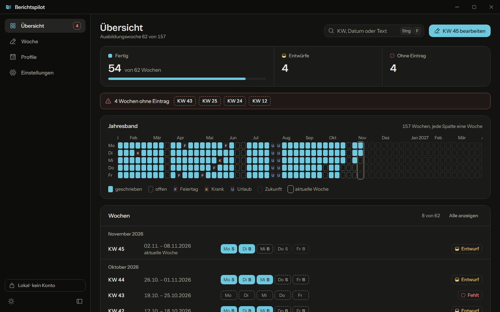
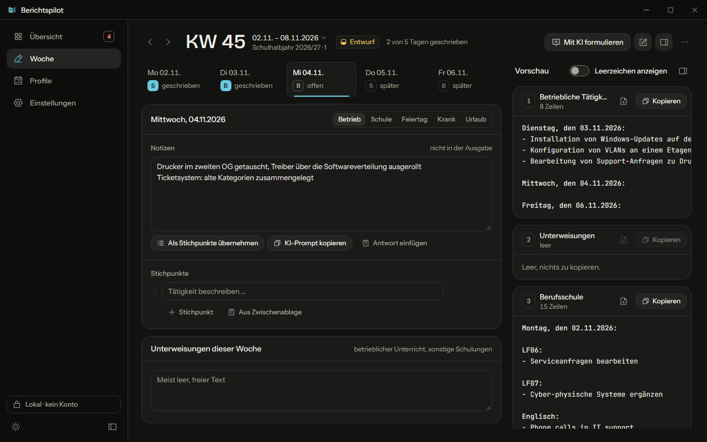
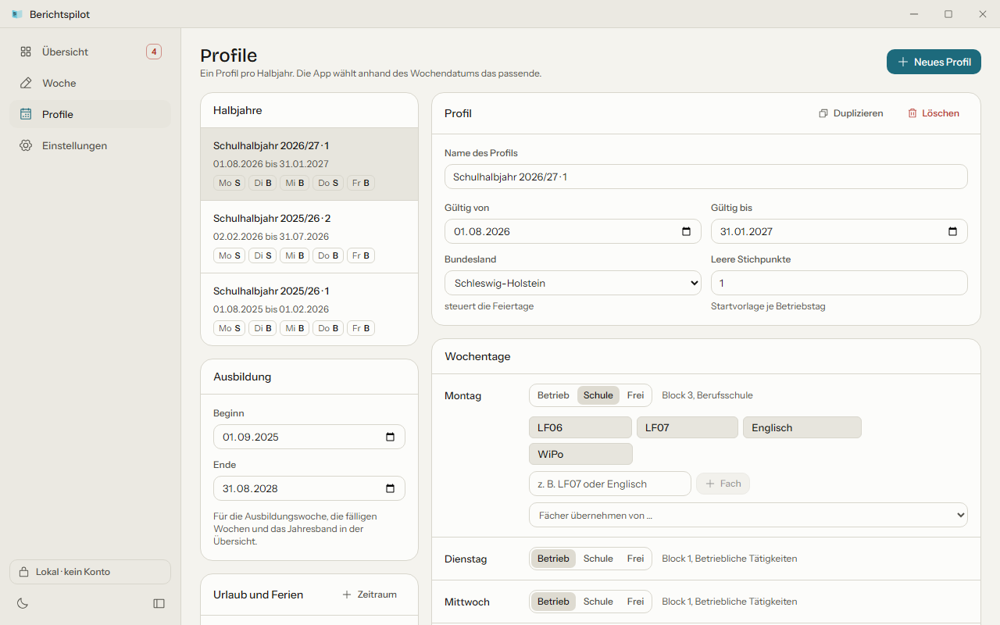

<div align="center">

# Berichtspilot

**Dein IHK-Berichtsheft in ein paar Minuten pro Woche.**

[](LICENSE)




</div>

## Worum geht's?

Das IHK-Portal will pro Woche drei Textfelder. Berichtspilot erzeugt sie dir fertig formatiert. Du prüfst nur noch und kopierst.

- Datum, Wochentage und Feiertage kommen automatisch.
- Schul- und Arbeitstage stellst du einmal pro Halbjahr ein.
- Unterrichtsthemen holst du dir auf Wunsch aus WebUntis.
- Aus Stichworten macht eine KI deiner Wahl saubere Stichpunkte. Ein API-Key ist nicht nötig, du kopierst einfach hin und her.
- Alles läuft lokal. Ohne Konto, ohne Cloud.

## Installation

Download unter **[Releases](https://github.com/Rexi255/berichtspilot/releases)**.

**Windows:** `Berichtspilot-Setup-<version>.exe` ausführen. Admin-Rechte brauchst du nicht.

> **Windows warnt beim ersten Start?**
> Die Meldung „Der Computer wurde durch Windows geschützt“ ist normal. Der Installer ist nicht signiert, deshalb kennt Windows den Herausgeber nicht.
> Klick auf **Weitere Informationen** und dann auf **Trotzdem ausführen**.
> Bei Updates aus der App heraus kommt die Warnung nicht mehr.

**Linux:** `Berichtspilot-<version>.AppImage` herunterladen, `chmod +x`, starten.

## Updates

Die App schaut beim Start auf GitHub nach einer neuen Version. Gibt es eine, erscheint unten in der Seitenleiste eine Karte. Heruntergeladen und installiert wird nur, wenn du klickst.

Abschalten kannst du das unter Einstellungen → Updates.

**Von 1.x kommend:** 2.0 einmal von Hand installieren. Deine Daten werden beim ersten Start automatisch übernommen. Danach können ältere Versionen die Datei nicht mehr öffnen, also vorher exportieren, falls du eine Kopie willst.

## Funktionen

- Übersicht mit Jahresband (jeder Tag der Ausbildung auf einen Blick) und Erkennung fehlender Wochen
- Mitten in der Ausbildung eingestiegen? Frühere Wochen lassen sich ignorieren, dann fehlen sie nicht
- Wocheneditor mit allen Tagen auf einer Seite (Tageskacheln oben springen zum Tag) und einer Vorschau, die genau den Text zeigt, der kopiert wird
- Notizen pro Tag, die per Klick zu Stichpunkten werden (mit oder ohne KI, für einen Tag oder die ganze Woche)
- Warnung vor möglichen Kundendaten, bevor du kopierst oder Text an eine KI geht
- Hell und Dunkel, vier Akzentfarben
- WebUntis-Import für jede Schule in der WebUntis-Cloud
- Profile pro Schulhalbjahr, Urlaub und Schulferien als Zeiträume
- Feiertage für alle 16 Bundesländer, komplett offline
- Volltextsuche, Autovervollständigung, eigene Textbausteine
- Tastenkürzel (z. B. Strg+1/2/3 kopiert die Blöcke) und deutsche Rechtschreibprüfung
- Einrichtungsassistent beim ersten Start

Alle Änderungen: [CHANGELOG.md](CHANGELOG.md)

| Wocheneditor | Profile (hell) |
| :---: | :---: |
|  |  |

*Screenshots mit Demodaten.*

## Wo liegen meine Daten?

Alles steckt in einer Datei: `daten.json`.

- **Windows:** `%APPDATA%\Berichtspilot`. Bleibt bei der Deinstallation erhalten.
- **Linux:** neben der AppImage. Ist der Ordner schreibgeschützt, dann `~/.config/Berichtspilot`.

Daneben liegen bis zu drei Backups. Ist die Datei mal kaputt, nimmt die App automatisch das neueste intakte Backup. Den genauen Pfad siehst du unter Einstellungen → Daten.

Zusätzlich legt die App im Ordner `sicherungen` jeden Tag eine Sicherung an (die letzten 30 Tage bleiben) und eine weitere vor jedem Update, Import und Wiederherstellen. Zurückholen kannst du einen alten Stand unter **Einstellungen → Daten → Sicherungen**. Der aktuelle Stand wird dabei vorher selbst gesichert.

## Datenschutz

Dein Berichtsheft verlässt den Rechner nicht von allein. Nur zwei Funktionen gehen online, beide optional:

| Funktion | Verbindet sich mit | Abschalten |
|---|---|---|
| WebUntis-Import | dem WebUntis-Server deiner Schule | Einstellungen → Verbindungen (standardmäßig aus) |
| Update-Prüfung | GitHub | Einstellungen → Updates |

Dein WebUntis-Passwort gibst du direkt auf der Seite der Schule ein, die App sieht es nicht. „Mit KI formulieren“ schickt gar nichts selbst ab, du kopierst den Text selbst in den Chat.

## Entwicklung

Voraussetzung: Node.js 22.12 oder neuer (empfohlen: 24).

```bash
npm install
npm run dev            # App mit Hot Reload
npm test               # Tests
npm run test:e2e       # End-to-End-Tests (Playwright, Browser + Electron)
npm run lint           # ESLint
npm run build:win      # Windows-Installer nach release/
npm run build:linux    # AppImage nach release/ (unter Linux)
```

Releases baut die CI, sobald ein Tag `vX.Y.Z` gepusht wird. Der Tag muss zur Version in `package.json` passen.

Mehr Details:

- [CONTRIBUTING.md](CONTRIBUTING.md): wie man mitmacht
- [docs/OUTPUT_FORMAT.md](docs/OUTPUT_FORMAT.md): das exakte Ausgabeformat
- [docs/](docs/): Architektur, Datenmodell, Entscheidungen, Plan
- [CLAUDE.md](CLAUDE.md): Leitfaden für KI-Assistenten

## Hinweis

Inoffizielles, privates Tool. Keine Verbindung zur IHK oder zur Untis GmbH. Prüf die Texte vor dem Abschicken, die Verantwortung fürs Berichtsheft liegt bei dir. Nutzung auf eigenes Risiko.

## Lizenz

[MIT](LICENSE)
