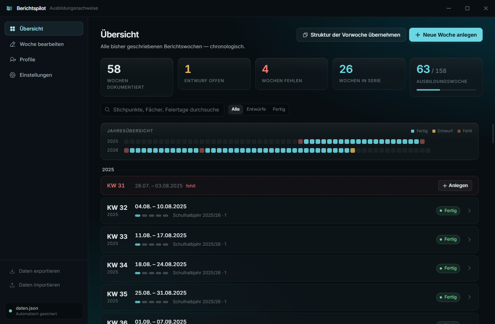
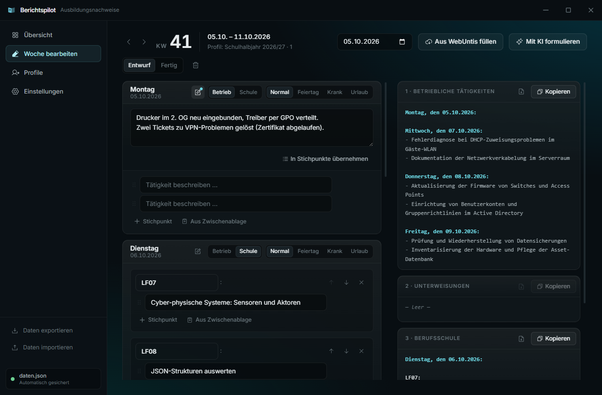
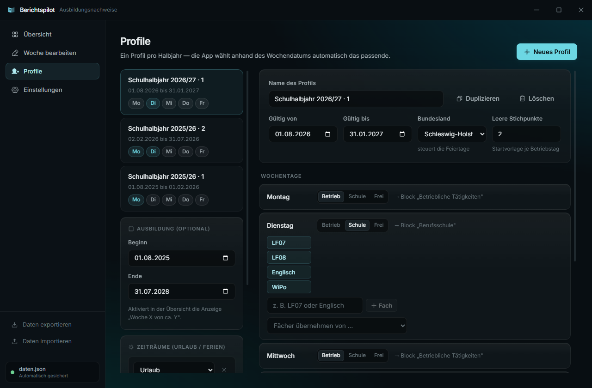

<div align="center">

# 📓 Berichtspilot

**Generator for the German IHK apprenticeship training record ("Berichtsheft")**

Produces, per training week, the three formatted text blocks that go 1:1 into the
digital IHK training record. Weekdays, dates, headings and public holidays are
filled in automatically, so you only type the actual activities.
The app's user interface is German.

[](LICENSE)




</div>

---

## What is it?

Apprentices in Germany must keep a weekly training record. The digital IHK portal
has three input fields for it. This app takes over the tedious part:

- **Dates & weekdays** are derived from the ISO week.
- **Public holidays** are detected fully offline (Gauss Easter formula, per federal state).
- **School and work days** come from a configurable **profile per school half-year**.
- The three **output blocks** are generated live in exactly the required format —
  including every blank-line rule — and copied to the clipboard with one click.

Everything runs locally. No cloud, no account, no internet connection required.

## Features

- 🗂️ **Overview** of all training weeks with ISO week, date range, status
  (draft/done), progress line, **year heatmap** and **gap detection** (missing
  weeks with one-click creation).
- 🔎 **Full-text search & filters** across bullets, subjects and holidays — also
  handy as a lookup ("when did I configure that switch?").
- ✍️ **Week editor** with live preview of the three output blocks, copy buttons,
  **autocomplete** from all previous bullets + your own **snippets**, and
  **paste from clipboard** (time tracking/WebUntis).
- 🧑‍🏫 **Profiles per school half-year** — picked automatically by date,
  **duplicate** for the half-year switch, warnings for overlaps/gaps, subject
  lists copyable between days/profiles.
- 🏖️ **Periods:** enter vacations and school breaks once — vacation marks the days
  automatically; during school breaks, school days become work days.
- 🎉 **Offline holidays** for all 16 federal states, including movable holidays.
- 🏷️ **Day status** normal / holiday (auto) / sick / vacation.
- ⌨️ **Keyboard shortcuts** (Ctrl+1–4, Alt+←/→, Ctrl+Shift+1/2/3 to copy) and
  **German spell checking** in all input fields.
- 💾 **Robust storage:** all data in **one `daten.json`** — in the user data folder
  for the Windows installer, next to the AppImage on Linux.
  **Atomic writes** with rolling **backups** (`.bak1`–`.bak3`), **single-instance
  lock**, versioned schema with migration, and export/import with **merge or
  replace**. Deleting can be undone via toast.
- 🎨 Frameless window with custom title bar, 6 dark color themes, smooth GSAP transitions.

## Screenshots

| Week editor with live output | Profiles / half-years |
| :---: | :---: |
|  |  |

Type on the left; the finished target format appears instantly on the right with a
copy button.

## Installation (prebuilt app)

Builds are available under **[Releases](https://github.com/Rexi255/berichtspilot/releases)**:

- **Windows (recommended):** `Berichtspilot-Setup-<version>.exe` — the installer.
  Creates start-menu and desktop shortcuts; the install folder is selectable and the
  default install is per user, **without admin rights**.
- **Linux:** `Berichtspilot-<version>.AppImage` — make it executable (`chmod +x`) and run it.

### Where is my data?

- **Windows (installer):** in the user data folder `%APPDATA%\Berichtspilot`. It is
  **always writable** — even when the app lives under `C:\Program Files`.
  Uninstalling keeps the data.
- **Linux (AppImage):** in `daten.json` **next to the AppImage** — move the folder and
  the data moves with it. If that folder is read-only, the app falls back to
  `~/.config/Berichtspilot` instead of crashing.
- **Coming from the portable `.exe` (up to v1.2.0)?** There is no portable build any
  more. Install the setup and either import your export, or copy the `daten.json`
  from next to the old portable `.exe` into `%APPDATA%\Berichtspilot` (app closed).

The exact path is shown in the bottom-left of the sidebar (tooltip). Up to three
rolling backups (`.bak1`–`.bak3`) live next to `daten.json`; if the main file is
ever corrupted, the app restores the newest intact backup on start. For manual
backups/moves there is also **export/import**.

## Development

Requires **Node.js ≥ 20.19**.

```bash
npm install
npm run dev        # Vite dev server + Electron with hot reload
npm start          # build renderer + start Electron on the build
npm test           # Vitest: format (real IHK examples), holiday, date, model logic
npm run lint       # ESLint (also runs in CI on every push/PR)
```

Contributor and AI-assistant guidelines: [CONTRIBUTING.md](CONTRIBUTING.md) and
[CLAUDE.md](CLAUDE.md). Architecture, data model and decisions live in [`docs/`](docs/).

## Build

```bash
npm run build:win    # Windows: installer (.exe) + latest.yml     -> release/
npm run build:linux  # Linux AppImage                             -> release/ (run on Linux)
npm run build        # both platforms
```

With [CI](.github/workflows/release.yml): pushing a version tag
(`git tag v1.0.1 && git push --tags`) builds both artifacts and attaches them to a
GitHub release.

## Output format

The format is mandatory and matches real IHK reports exactly (the output is
German). Full specification: [docs/OUTPUT_FORMAT.md](docs/OUTPUT_FORMAT.md).

**Block 1 — Betriebliche Tätigkeiten** (one blank line between days):

```
Mittwoch, den 08.07.2026:
- Fehlerdiagnose bei DHCP-Zuweisungsproblemen und Behebung lokaler Netzwerkstörungen
- Verwaltung von WLAN-Zugangsdaten für Gäste sowie Bearbeitung von Support-Tickets
```

Holiday/sick/vacation replace the bullets with a status line
(`- Feiertag: Tag der Arbeit`, `- Krankheitstag`, `- Urlaub`).

**Block 2 — Unterweisungen:** free text, usually empty.

**Block 3 — Berufsschule** (header, blank line, subjects with bullets; one blank
line between subjects, **two** between days):

```
Montag, den 06.07.2026:

LF02:
- Kaufvertrag und Leistungsstörungen

Englisch:
- Explaining a network diagram in English
```

## Project structure

```
electron/
  main.js        # window, data location + safe saving, file I/O via IPC
  preload.js     # narrow contextBridge API for the renderer
src/
  lib/dates.js   # weekday/date, ISO week
  lib/holidays.js# holidays per federal state (Easter formula, offline)
  lib/format.js  # exact output format of the three blocks
  lib/model.js   # profiles, weeks, seed data, migration
  views/         # Overview · WeekEditor · Profiles · Settings
  ui/            # title bar, sidebar, design-system components
docs/            # architecture, data model, output format, glossary, decisions, plan
CLAUDE.md        # working guide for AI assistants (Claude Code)
```

## Technology & security

- **Electron + Vite + React + Tailwind CSS**, animations with GSAP & Lenis.
- **Electron hardening:** `contextIsolation: true`, `nodeIntegration: false`,
  `sandbox: true`. The renderer only gets a narrow API via the preload bridge; file
  I/O happens exclusively in the main process (IPC). Strict CSP in the renderer.
- **Offline by design:** holidays are computed locally, no external requests.

## Roadmap

Berichtspilot is being extended into a largely automatic training record: voice
dictation, WebUntis import and AI phrasing. Status, order and open questions:
**[docs/PLAN.md](docs/PLAN.md)**.

## Contributing

Pull requests and issues are welcome — see **[CONTRIBUTING.md](CONTRIBUTING.md)**.

## Disclaimer

Unofficial, private helper tool. **Not** affiliated with or endorsed by any IHK or
the IHK portal. Always review the generated texts before submitting — every
apprentice is responsible for the correctness and completeness of their training
records. Use at your own risk, without warranty.

## License

[MIT](LICENSE)
